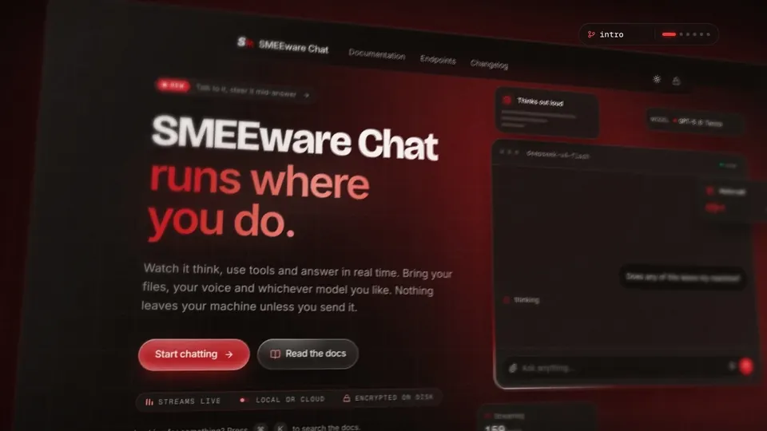
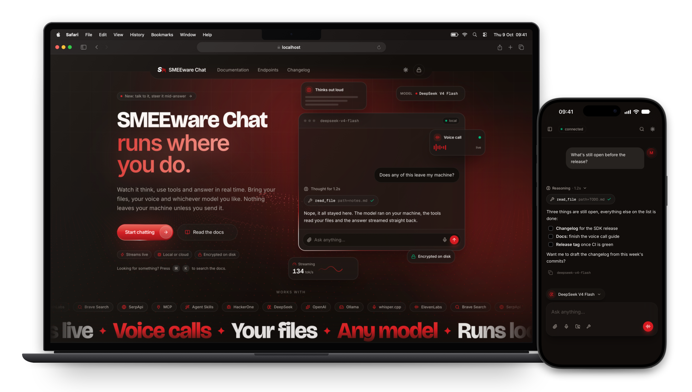

<p align="center">
  
</p>

<h1 align="center">SMEEware Chat</h1>

<p align="center">
  A local-first AI chat that <strong>runs where you do</strong> — reasoning, tool
  calls and the reply stream in live, with your files, your voice and the model
  you chose. Nothing leaves your machine until you send it.
</p>

<p align="center">
  <a href="assets/smeeware-chat-demo.mp4">
    
  </a>
  <br />
  <sub>▶ <a href="assets/smeeware-chat-demo.mp4">Watch the 30-second demo with sound</a></sub>
</p>

---

A **Next.js** frontend (chat, docs and landing) and a **FastAPI** backend (LLM
providers, tools, encrypted chat storage, voice) in one repository, started by a
single script. The browser talks only to the frontend; the backend stays
private.

<p align="center">
  
</p>

## Highlights

- **Streaming, and steerable.** Reasoning, tool calls and the answer arrive as
  Server-Sent Events. Keep typing while it works — your note joins the running
  turn at the next step.
- **Voice call.** Talk hands-free; a free neural voice answers while the text is
  still being written. Start talking to interrupt it.
- **Local or hosted.** Run a model on your own machine through **Ollama**, or a
  hosted one (DeepSeek, OpenAI). Same chat, same tools — you pick per message.
- **Tools & plugins.** Web search, page scraping, images, vision, weather,
  storage, a shell and more — switch them on per conversation.
- **Workspaces.** Point the model at a folder on the agent's host; every message
  carries that context.
- **File attachments.** Upload any file type, including ZIP and documents. Ask
  the model to read, unpack or edit working copies and return a download.
  Originals stay complete; images keep their previews. The default limit is
  20 MB per file and 8 files per message, configurable on the backend.
- **Encrypted at rest.** Chats and notices are encrypted with a key derived from
  your password. The key lives in memory only, never on disk.
- **Bilingual.** The whole UI and docs are available in English and German,
  switchable in Settings (auto-detected on first visit).

## Quick start

You need **Python 3.10+** and **Node.js 20+**.

```bash
git clone <your-repo-url> smeeware-chat
cd smeeware-chat
./install.sh
./start.sh
```

`install.sh` asks for your API keys (typed hidden, stored only in
`backend/.env`), configures feature switches to match what you entered,
and installs the Python and Node dependencies. `ROOT` is a manual setting in
`backend/.env`. Skipping setup works too —
`./start.sh` runs the setup on its first start.

Then open **http://localhost:3000**. `Ctrl+C` stops everything.

```bash
./start.sh                    # development: hot reload (default)
./start.sh -build             # production build, no reload
./start.sh -ollama qwen3:8b   # also offer a local model through Ollama
./start.sh -shell             # allow shell commands for this run (local use only)
./install.sh --configure      # change keys and switches later
```

## API keys

**Only `DEEPSEEK_API_KEY` is required.** Every other key unlocks extra
features. Without it, those features stay switched off and are hidden in the
UI, so nothing half-works.

| Key                                              | Required | What it unlocks                                                                                     | Get it                                                         |
| ------------------------------------------------ | :------: | --------------------------------------------------------------------------------------------------- | -------------------------------------------------------------- |
| `DEEPSEEK_API_KEY`                               | **yes**  | The chat (DeepSeek V4 Flash & Pro) and image understanding                                          | [platform.deepseek.com](https://platform.deepseek.com)         |
| `OPENAI_API_KEY`                                 |    –     | GPT-5.6 models, image generation, voice input and voice calls                                       | [platform.openai.com](https://platform.openai.com/api-keys)    |
| `ELEVENLABS_API_KEY`                             |    –     | Natural read-aloud voices in every language. Without it, a free, **English-only** voice reads aloud | [elevenlabs.io](https://elevenlabs.io)                         |
| `BRAVE_API_KEY`                                  |    –     | Web and image search                                                                                | [brave.com/search/api](https://brave.com/search/api/)          |
| `BRAVE_ANSWERS_API_KEY`                          |    –     | Short, sourced answers (separate Brave plan)                                                        | [brave.com/search/api](https://brave.com/search/api/)          |
| `SERPAPI_API_KEY`                                |    –     | Google Maps, YouTube search and transcripts                                                         | [serpapi.com](https://serpapi.com)                             |
| `HACKERONE_API_USERNAME` + `HACKERONE_API_TOKEN` |    –     | Bug bounty programs and report drafts (needs both)                                                  | [hackerone.com](https://hackerone.com/settings/api_token/edit) |

### Switches

These need no API key. `install.sh` configures the listed features except
`ROOT`; set that manually in `backend/.env` and restart the backend.

| Setting                                                     | Default          | What it does                                                                                                          |
| ----------------------------------------------------------- | ---------------- | --------------------------------------------------------------------------------------------------------------------- |
| `SHELL_ENABLED`                                             | `false`          | Lets the model run shell commands. Not sandboxed: local, single-user setups only                                      |
| `ROOT`                                                      | `false`          | Allows `sudo` and `su` through the shell command guard. Requires enabled shell tools; grants no OS privileges          |
| `TRANSCRIBE_MODEL`                                          | `gpt-transcribe` | `whisper-local` transcribes on your machine (whisper.cpp + ffmpeg), so voice input works without OpenAI               |
| `OLLAMA_ENABLED` + `OLLAMA_MODEL`                           | off              | Offers a local model through [Ollama](https://ollama.com). Pick one that can reason and call tools, e.g. `qwen3:8b`   |
| `STORAGE_ENABLED` + `STORAGE_ALIAS` + `STORAGE_PUBLIC_BASE` | off              | An S3 bucket the model can write to, through the [mc](https://min.io/docs/minio/linux/reference/minio-mc.html) client |
| `SECRET`                                                    | generated        | Encrypts shared chats. Sharing stays off while it is empty                                                            |
| `REQUIRE_API_KEY`                                           | `false`          | Turn on when the backend itself is reachable from the internet                                                        |

Everything else has sensible defaults. The full reference is in
[`backend/README.md`](backend/README.md#configuration).

## Deployment

A Docker setup is included:

```bash
docker compose up -d --build       # backend + frontend (Ollama optional via profile)
```

On updates, `git pull && docker compose up -d --build` rebuilds only what
changed; chat history and uploads live in a named volume and survive rebuilds.
The full path — GitHub to server, TLS, the Ollama options and a bare-metal
variant — is in **[DEPLOY.md](DEPLOY.md)**.

## Documentation

The app ships its own docs at **`/docs`** (quickstart, authentication, streaming,
the full endpoint reference, and the chat-app features). Backend architecture is
in [`backend/README.md`](backend/README.md); the frontend in
[`frontend/README.md`](frontend/README.md).

## Project structure

```
smeeware-chat/
├── frontend/            Next.js app (chat + docs + landing)
├── backend/             FastAPI server, LLM tools, chat storage, .env
├── install.sh           Interactive setup: keys, switches, dependencies
├── start.sh             Starts backend + frontend
├── docker-compose.yml   Deployment: backend + frontend (+ optional Ollama)
├── DEPLOY.md            GitHub → server (Docker or bare-metal)
└── assets/              README images and the demo video
```
